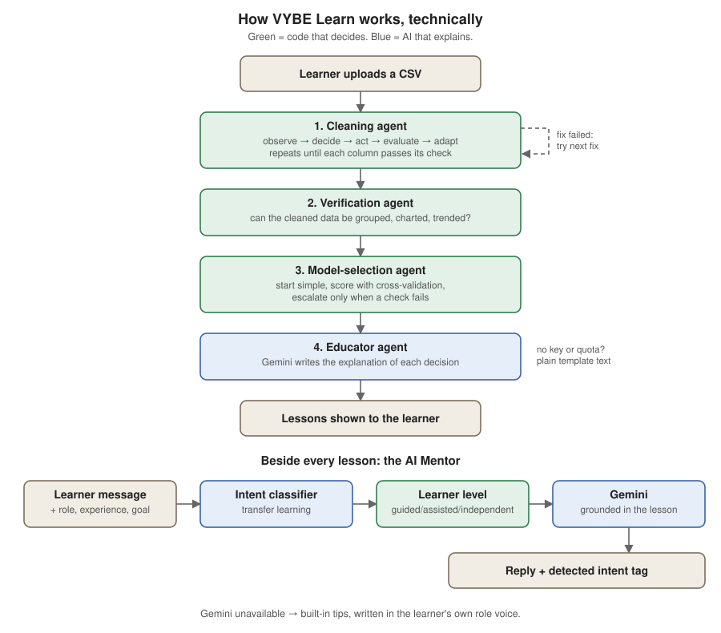
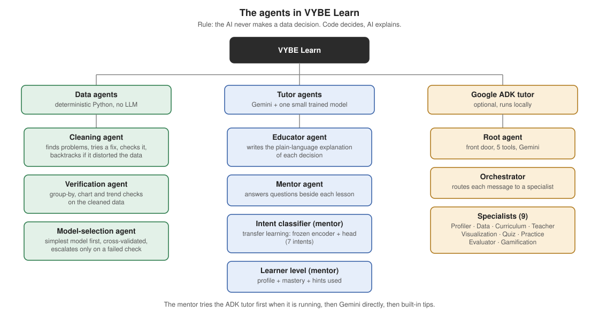

# VYBE Learn: An Agentic Data Cleaning & Modeling Educator

VYBE Learn teaches data science to people who are not data scientists (sales, operations, HR).
They bring their own messy spreadsheet. A set of agents cleans it, checks that the cleaning
actually worked, picks a prediction model, and then a tutor explains every decision in plain
words. An AI Mentor sits beside each lesson and answers questions.

## The problem

People in non-technical jobs have real data they want to understand. Today they get two
extremes: generic courses on textbook datasets, or nothing. So they avoid their data, hand it
to someone else, or guess.

## Why agents, not a script or a chatbot

- A **script** applies one fixed rule and never checks whether it hurt the data.
- A **chatbot** can describe cleaning steps but cannot check its own work.

Our cleaning agent runs a loop instead:

1. **Observe**: find the real problems (missing values, inconsistent labels, mixed formats).
2. **Decide**: pick the first fix to try for that kind of problem.
3. **Act**: apply it.
4. **Evaluate**: measure the data again. Did the fix distort it?
5. **Adapt**: if it did, throw the fix away and try the next one.

**A real example.** In a sales dataset with a few very large deals, filling missing values with
the median distorted the data by 21%. The agent noticed, discarded that fix, and switched to
KNN imputation, which distorted it by only 7.6%.

```
[issue] deal_value: missing_numeric
  -> tried impute_median: FAILED, skew shifted 21.3% (limit 15%)
  -> tried impute_knn:    PASSED, skew shifted 7.6%
```

## How it works



The top half is the data pipeline. Each agent does one job and hands its result to the next.
The bottom half is the AI Mentor, which runs alongside every lesson.

**One rule runs through the whole system: the AI never makes a data decision.** Code decides
(rules and statistical checks), and the AI only explains. That makes every decision checkable,
and the app keeps working when the AI is unavailable.

## The agents



| Agent | Where | Job | Decides with |
|---|---|---|---|
| Cleaning agent | `app/agent/` | Finds problems, fixes them, backtracks if a fix distorts the data | Rules and statistical thresholds |
| Verification agent | `app/evaluation/` | Checks the cleaned data can really be grouped, charted and trended | Rules |
| Model-selection agent | `app/modeling/` | Starts with the simplest model, escalates only when a check fails | Cross-validation and residual checks |
| Educator agent | `app/educator/` | Writes the plain-language explanation of each decision | Gemini, with template text as a fallback |
| Mentor agent | `web/chat.py` | Answers the learner's questions beside each lesson | Intent classifier, learner level, then Gemini |
| Google ADK tutor | `adk-tutor/` | Optional front door with 9 specialists (profiler, teacher, quiz and so on) | Gemini plus rules. It runs locally, not in the deployed demo |

## How the mentor decides what to say

1. The learner types a message. We also know their role, experience and goal.
2. **Small talk** ("hi", "thanks") is caught by a simple rule, so it never counts as off-topic.
3. The **intent classifier** works out what they are asking for: a concept, a hint, why they
   were wrong, a next step, an example, frustration, or something off-topic.
4. **Learner level** (`web/persona.py`) turns their profile, mastery and hints used into one of
   three support levels: guided, assisted or independent.
5. **Gemini** writes the reply, grounded in the lesson on screen. The prompt carries the role
   (a student gets study-buddy wording, a salesperson gets sales wording).
6. If Gemini is unavailable, built-in tips answer in the same role voice.

The classifier only routes. It picks one guidance line for the prompt and never writes an
answer or touches the data.

## Transfer learning

Step 3 above is the transfer learning. A pretrained text encoder (`BAAI/bge-small-en-v1.5`)
is kept frozen and turns each message into 384 numbers that capture its meaning. We train
only a small classifier on top, using 186 labelled learner questions.

| Test | Transfer learning | Plain TF-IDF baseline |
|---|---|---|
| 5-fold cross-validation | 93.5% | 71.0% |
| 2 labelled examples per intent | 73.2% | 41.1% |
| 8 labelled examples per intent | 87.1% | 57.9% |

The rows with few examples are the main result: the pretrained encoder helps most when labels
are scarce. Reproduce with `python -m app.intent`. Details and caveats:
`docs/transfer-learning.md`.

## Running it

```bash
pip install -r requirements.txt
cp .env.example .env        # add GEMINI_API_KEY (optional)

python run_web.py --port 8000          # backend
npm --prefix web/ui install            # first time only
npm --prefix web/ui run dev            # frontend at http://localhost:5173
```

Log in with `demo` / `demo123` (or `admin` / `admin123`), or answer three quick questions.
Without a Gemini key everything still works with built-in text. The free Gemini tier allows
about 20 requests a day. When it runs out, the app says so and uses built-in tips until the
quota resets. `/api/health` shows the current state.

Command line, no browser: `python3 run_full_demo.py` runs the whole pipeline on the included
sales dataset and prints every stage.

Tests (keys blanked so a real key cannot change the result):

```bash
GEMINI_API_KEY= GOOGLE_API_KEY= python -m pytest tests
```

Deployment: the frontend is on Vercel and the backend on Render (`vybe-learn`). Set
`VITE_API_BASE` on Vercel to the backend's address, and `GEMINI_API_KEY` and
`CORS_ALLOW_ORIGINS` on Render.

## What changed after the first draft

- Added the transfer-learning intent classifier and the learner levels.
- Merged the two chats into one AI Mentor, with small talk and friendly off-topic replies in
  the learner's own role voice.
- Simpler lessons, a login page first, and flashcards plus a quiz after EDA, ML foundations
  and modeling.
- Much faster: a 2,000-row upload went from 36 seconds to about 1, because model selection now
  runs in the background and lesson text is written only when it is needed.
- Switched from Claude to Gemini, with a pause-and-fallback when the free quota runs out.

More detail: `docs/architecture.md`, `docs/agents-and-demo.md`, `docs/transfer-learning.md`.

## Limitations

- Category matching uses Python's `difflib`, and aliases such as "Bombay" to "Mumbai" come from
  a small hand-written dictionary, not from learning.
- Model selection supports regression only (Linear, Ridge, Random Forest, Gradient Boosting).
- The verification check runs once, after cleaning. It does not trigger a second cleaning pass.
- The intent classifier was trained on questions the team wrote, not real learners, and it
  labels some nonsense input as off-topic.
- The ADK tutor is not deployed. The deployed app uses Gemini directly.

## Team

- **Person A**: agentic core (detection, cleaning, evaluation, backtracking, verification,
  model selection)
- **Person B**: LLM explanation layer (prompts, API integration, fallback)
- **Person C**: demo UI, datasets, documentation, demo script
